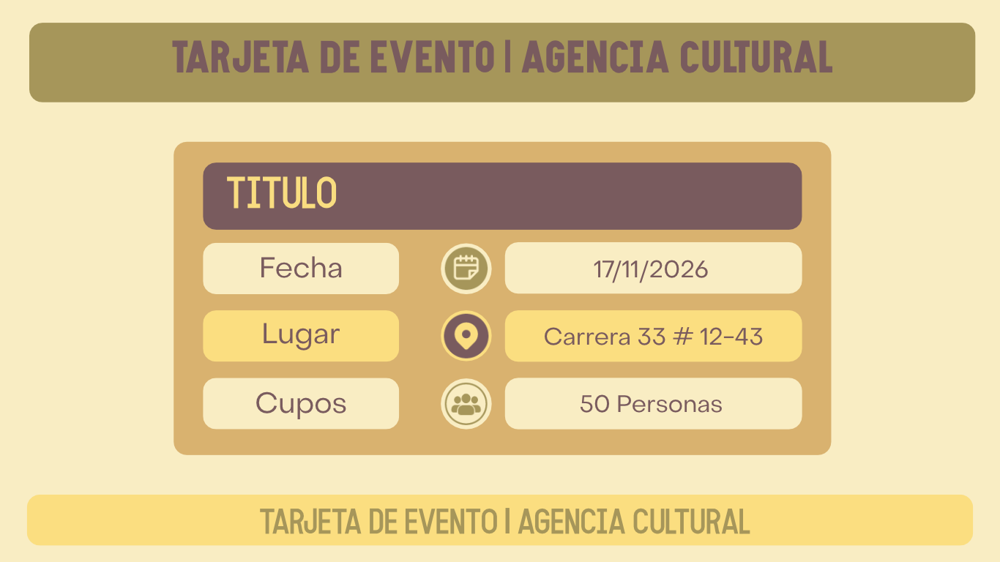

# Actividad Evaluativa: Web Components, HTML Templates y Frameworks

Proyecto colaborativo desarrollado para la práctica de componentes nativos en JavaScript sin librerías externas.

##  Integrantes del Equipo
* **Mariana Reyes:** Monta la base del repositorio, la primera parte de la teoría y la estructura visual en HTML.
* **Sara Villanueva Caro:** Desarrollo de la lógica en JavaScript, estructuración del Shadow DOM y documentación final.

##  Caso Elegido (Parte 3)
* **Tarjeta de evento para una agenda cultural:** Componente personalizado (`<tarjeta-evento>`) que muestra la información de eventos con título, fecha, lugar, cupos y un slot libre para notas adicionales.

##  Estructura del Repositorio
* `index.html`: Contiene la estructura de la página, el `<template>` personalizado con sus estilos internos y las 3 instancias requeridas.
* `js/main.js`: Lógica del Web Component (clase que extiende `HTMLElement`, Shadow DOM en modo "open", ciclo de vida y observación de atributos).
* `style.css`: Estilos generales de la interfaz de la agenda cultural.
* `INVESTIGACION.md`: Respuestas teóricas de la Parte 1 y Parte 2, tabla comparativa de frameworks y fuentes de consulta.

##  Instrucciones para Probar el Componente
1. Clona este repositorio o descarga los archivos en tu equipo local.
2. Abre el archivo `index.html` en tu navegador web de preferencia (se recomienda altamente usar la extensión **Live Server** en Visual Studio Code).
3. Verifica en la interfaz web que se rendericen correctamente las 3 instancias del componente con sus respectivos atributos y descripciones libres mediante el slot.
4. Abre las Herramientas de Desarrollador (F12) para comprobar que no existen errores en consola y que el Shadow DOM encapsula correctamente la estructura.

## Mockup
En este mockup se basa el diseño aplicado al producto 
   

##  Declaración de Uso de Inteligencia Artificial
Este proyecto fue desarrollado utilizando herramientas de Inteligencia Artificial (como Gemini) como un asistente de apoyo consultivo y de guía conceptual para:
* Verificar buenas prácticas de sintaxis en JavaScript vainilla (clases, `customElements.define`, ciclo de vida y Shadow DOM).
* Asegurar el cumplimiento de cada uno de los criterios exigidos en la rúbrica de evaluación.

Ambos integrantes comprenden a cabalidad el código fuente entregado, su funcionamiento nativo y la lógica implementada.